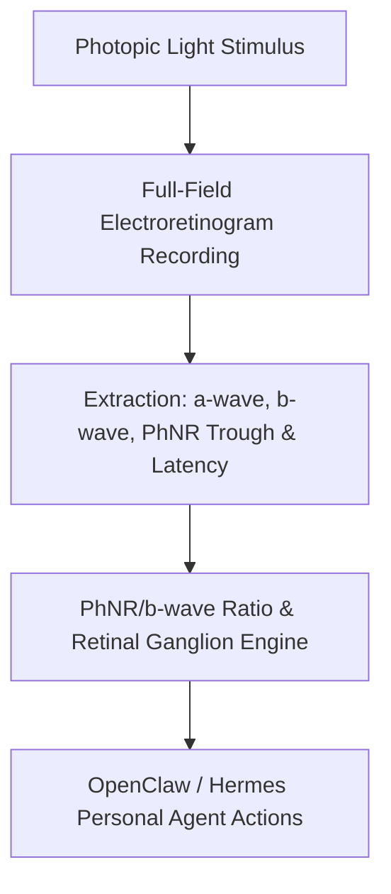

# Electroretinogram Photopic Negative Response (PhNR) Skill

[](LICENSE)
[](https://www.python.org/)
[](requirements.txt)
[](mcp_server.py)
[](SKILL.md)

Zero-dependency sovereign personal agent skill for non-invasive analysis of Electroretinogram Photopic Negative Response (PhNR), retinal ganglion cell health, and ocular strain.



## Features
- **Deterministic Math**: Pure Python standard library implementation with zero external dependencies.
- **ISCEV Standard Electrophysiology**: Implements clinical electroretinography standards for photopic negative response quantification.
- **Retinal Ganglion Strain Stratification**: Quantitative detection of inner retinal stress before irreversible visual loss.
- **Model Context Protocol (MCP)**: Native JSON-RPC tool integration for LLMs and autonomous agents.

## Quickstart

```python
from client import ElectroretinogramPhNRClient

client = ElectroretinogramPhNRClient()
result = client.evaluate_phnr(
    b_wave_amplitude_uv=118.0,
    phnr_amplitude_uv=46.5,
    phnr_latency_ms=71.5
)
print("PhNR/b-wave Ratio:", result["phnr_b_wave_ratio"])
print("Classification:", result["classification"])
```

## License
Apache-2.0
